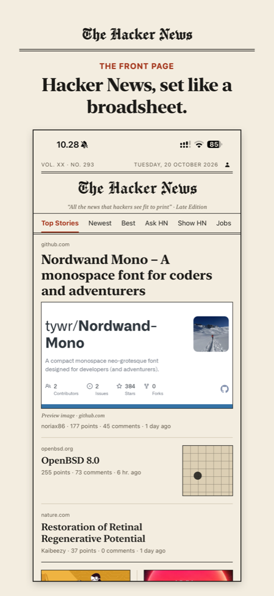
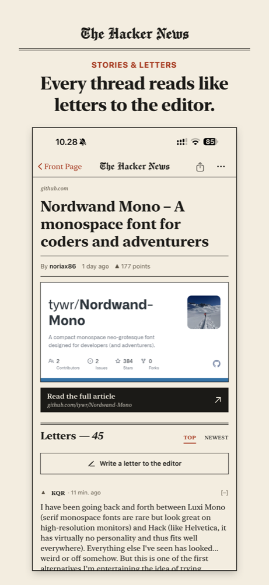
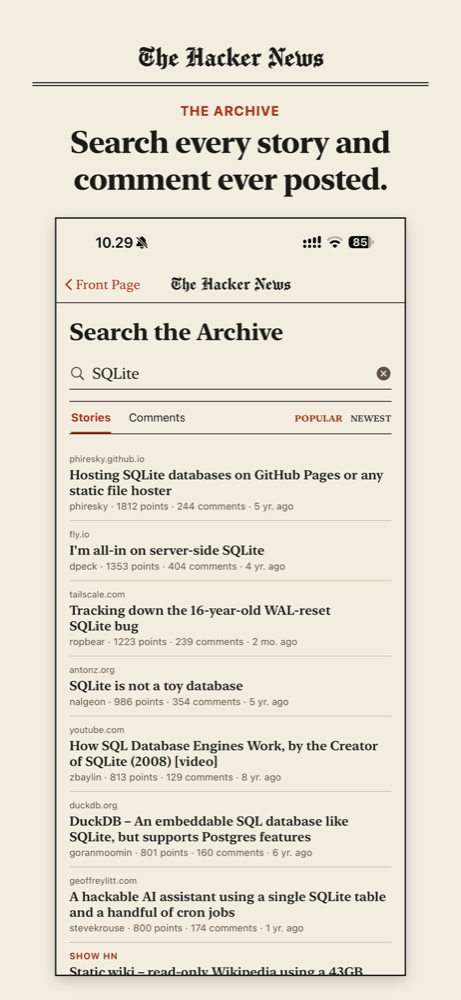
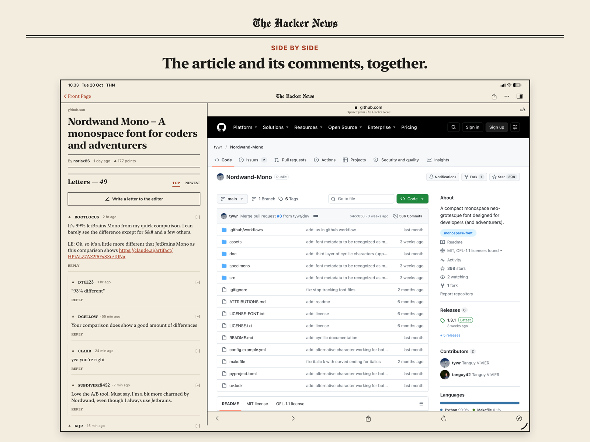

# THN — The Hacker News

Hacker News, typeset like a morning broadsheet. A native iPhone and iPad reader with
sign-in, voting, commenting, profiles and search, in a cream-newsprint design with a
blackletter masthead.

<p>
  
  
  
</p>



## Free software

THN is free software under the [GNU GPL-3](LICENSE). Build it, change it, share it.

## Features

- Front page, Newest, Best, Ask HN, Show HN and Jobs, laid out as a broadsheet
- Comment threads as "letters to the editor", collapsible, sorted by top or newest
- In-app article reader; side-by-side article and comments on iPad
- Sign in or create a Hacker News account (with a web sign-in fallback for captchas)
- Upvote, downvote and unvote stories and comments
- Comment, reply, edit and delete your own comments
- Favorite, hide, flag, edit and delete stories; submit links and Ask HN posts
- Profiles with karma, about text, submissions, comments and favorites; your upvoted and
  hidden lists; profile editing
- Search across all stories and comments (Algolia)

## Building

Requirements: Xcode 27 or later, iOS/iPadOS 27 SDK. No third-party dependencies.

```sh
git clone https://github.com/hpetersen/THN.git
cd THN
open "THN - The Hacker News.xcodeproj"
```

1. Select the **THN - The Hacker News** scheme and your device.
2. Signing: choose your team under *Signing & Capabilities*, or create
   `Config/Local.xcconfig` (git-ignored):

   ```
   DEVELOPMENT_TEAM = ABCDE12345
   // Optional; the default is an Xcode placeholder ID that works for development.
   PRODUCT_BUNDLE_IDENTIFIER = com.yourname.thn
   ```

3. Build and run.

A free Apple ID works for running on your own device (apps signed this way expire after
7 days; rebuild to renew).

### Launch arguments (for screenshots)

| Argument | Effect |
|---|---|
| `-screen story` / `-screen browser` | Opens the first busy story (and its article) |
| `-screen account` / `-screen search` / `-screen user:pg` | Opens that screen |
| `-query SQLite` | Pre-fills and runs a search |
| `-feed show` | Starts on a section |

## How it works

Reading uses the official [Hacker News Firebase API](https://github.com/HackerNews/API) and
the [Algolia HN Search API](https://hn.algolia.com/api). Hacker News has no write API, so
signed-in actions use the same links and forms as the website (`HackerNews/HNWeb.swift`):
vote and favorite links carry a per-item `auth` token, and forms carry an `hmac`. The only
thing stored is the `user` cookie, in the Keychain.

| File | Role |
|---|---|
| `HNClient.swift` | Firebase + Algolia reading |
| `HNWeb.swift` | Sign-in, voting, forms (HTML scraping) |
| `Session.swift` | Signed-in account, Keychain |
| `FrontPageView.swift`, `StoryView.swift` | Front page, story and comments |
| `ProfileView.swift`, `SearchView.swift`, `SignInView.swift` | Accounts, profiles, search |
| `Extras.swift` | Build-specific hooks; empty in source builds |
| `Theme.swift`, `PaperChrome.swift` | Palette, type and shared newspaper chrome |

## Contributing

Contributions are welcome. Please read [CONTRIBUTING.md](CONTRIBUTING.md); pull requests
need a one-time signature of the [Contributor License Agreement](CLA.md).

## Credits

- Masthead typeface: [Chomsky](https://github.com/ctrlcctrlv/chomsky) by Fredrick R. Brennan,
  SIL Open Font License (`HackerNews/Fonts/Chomsky-OFL.txt`).
- THN is an independent project, not affiliated with Y Combinator or Hacker News.

## License

Copyright © 2026 Henrik Petersen.
Licensed under the [GNU General Public License v3.0](LICENSE).
